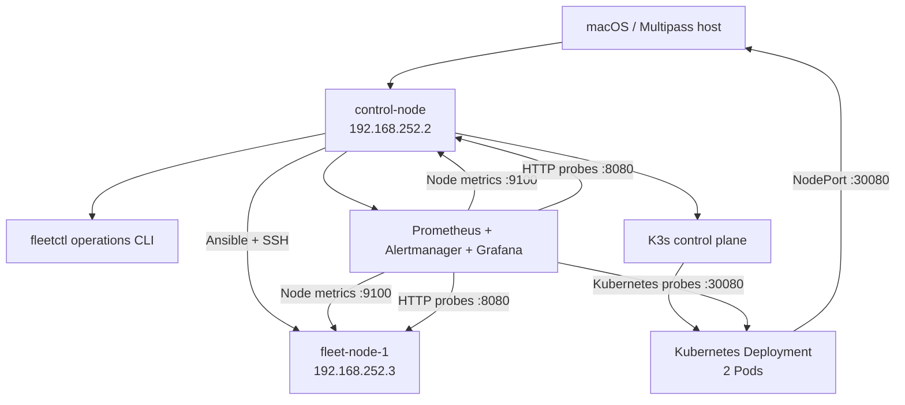

# Linux Systems & Reliability Lab

A two-node Linux operations lab for provisioning, monitoring, diagnosing, and
recovering services across a small server fleet.

The project models the operational workflow used by fleet reliability teams:

```text
provision -> validate -> monitor -> detect -> diagnose -> remediate -> verify
```

## Architecture



Each node runs:

- a hardened systemd-managed web service;
- an internal systemd health-check timer;
- Prometheus Node Exporter;
- a dedicated unprivileged service account.

The control node additionally runs:

- Ansible for idempotent fleet provisioning;
- `fleetctl` for health checks, diagnostics, and remediation;
- Prometheus, Blackbox Exporter, Alertmanager, and Grafana.

The optional Kubernetes extension runs a lightweight K3s control plane on the
control node, joins `fleet-node-1` as an agent, and distributes two hardened
application Pods across the two nodes.

## Reliability Features

- systemd startup and automatic process recovery;
- dedicated service identity and filesystem permissions;
- systemd hardening with `NoNewPrivileges`, `ProtectSystem`, and `ProtectHome`;
- idempotent multi-node Ansible provisioning;
- concurrent external HTTP and metrics checks;
- node, CPU, memory, disk, and workload alerts;
- provisioned Grafana dashboard and Prometheus datasource;
- remote evidence collection before remediation;
- explicit confirmation for service-changing fleet operations;
- runbooks and evidence-based postmortems;
- automated configuration validation in CI.
- a two-node K3s cluster with topology-aware Pod placement;
- Kubernetes startup, readiness, and liveness probes;
- non-root containers with resource limits and restricted security contexts;
- a PodDisruptionBudget and rolling-update strategy.

## Repository Layout

```text
.github/workflows/       CI validation for scripts and configuration
ansible/                 Fleet inventory and provisioning playbook
container/               Container image for the Kubernetes workload
config/                  fleetctl node inventory
docs/postmortems/        Completed incident reviews
docs/runbooks/           Detection, diagnosis, and recovery procedures
monitoring/              Prometheus, Alertmanager, Blackbox, and Grafana config
kubernetes/              Deployment, Service, namespace, and disruption budget
scripts/install.sh       Standalone single-node service installer
scripts/fleetctl.py      Fleet operations CLI
scripts/provision-fleet.sh
scripts/install-monitoring.sh
scripts/verify-lab.sh
systemd/                 Web service and health-check units
tests/                   Python unit tests for fleetctl
```

## Lab Requirements

- macOS with Multipass;
- approximately 5 GB of available RAM for both VMs;
- Ubuntu 26.04 LTS ARM64 or AMD64;
- Python 3 and Ansible on the control node;
- network access for Ubuntu packages and container images.

The checked-in inventory uses the following lab addresses:

| Node | Address | CPU | Memory | Disk |
| --- | --- | ---: | ---: | ---: |
| `control-node` (`reliability-lab`) | `192.168.252.2` | 2 | 4 GB | 30 GB |
| `fleet-node-1` | `192.168.252.3` | 1 | 1 GB | 8 GB |

Update `ansible/inventory.ini`, `config/fleet.json`, and
`monitoring/prometheus/prometheus.yml` if Multipass assigns different addresses.

## Provisioning

The control node requires Ansible and a dedicated SSH key that can access the
worker. The private key must remain outside Git at:

```text
/home/ubuntu/.ssh/fleet_lab_ed25519
```

From the repository on the control node, validate connectivity:

```bash
ansible -i ansible/inventory.ini fleet -m ping
```

Provision or update all nodes:

```bash
./scripts/provision-fleet.sh
```

A successful repeated run should report `changed=0`, demonstrating
idempotency.

## Kubernetes Extension

The Kubernetes workload is additive: the original systemd services continue
to run on port `8080`, while Kubernetes exposes the same application through
NodePort `30080`.

Install a two-node K3s cluster from the repository on the control node:

```bash
./scripts/install-k3s.sh
```

The playbook installs a K3s server on `reliability-lab`, joins
`fleet-node-1` as an agent, disables the bundled Traefik and ServiceLB
components to conserve lab resources, and waits for both nodes to become
`Ready`.

Build the non-root container image and import it into the K3s containerd image
store on both nodes:

```bash
./scripts/build-kubernetes-image.sh
```

Deploy the namespace, two-replica Deployment, NodePort Service, and
PodDisruptionBudget:

```bash
./scripts/deploy-kubernetes.sh
```

Verify node readiness, replica placement, rollout state, and both NodePort
paths:

```bash
./scripts/verify-kubernetes.sh
```

Inspect the resulting resources:

```bash
sudo k3s kubectl get nodes -o wide
sudo k3s kubectl -n reliability-lab get deployment,pods,service -o wide
```

The application is available through either node:

```text
http://192.168.252.2:30080/
http://192.168.252.3:30080/
```

The image uses `imagePullPolicy: Never` intentionally. This makes local image
distribution observable and avoids requiring credentials for an external
container registry. Re-run the image build/import script on both nodes before
deploying a new image tag.

## Fleet Operations

List nodes:

```bash
./scripts/fleetctl.py inventory
```

Check web and metrics health concurrently:

```bash
./scripts/fleetctl.py health
```

Produce machine-readable health output:

```bash
./scripts/fleetctl.py health --json
```

Collect diagnostic evidence:

```bash
./scripts/fleetctl.py diagnose fleet-node-1
```

Perform a confirmed service operation:

```bash
./scripts/fleetctl.py restart fleet-node-1 --yes
```

## Monitoring

Install and start the monitoring stack on the control node:

```bash
sudo ./scripts/install-monitoring.sh
```

The installer generates a local Grafana password in `monitoring/.env` with
mode `0600`. The file is ignored by Git.

Services are exposed on the control-node address:

| Component | Port | Lab URL |
| --- | ---: | --- |
| Grafana | `3000` | `http://192.168.252.2:3000` |
| Prometheus | `9090` | `http://192.168.252.2:9090` |
| Alertmanager | `9093` | `http://192.168.252.2:9093` |
| Blackbox Exporter | `9115` | `http://192.168.252.2:9115` |

The provisioned Grafana dashboard is named **Linux Fleet Overview**.

### Alert Rules

| Alert | Condition | Pending period |
| --- | --- | ---: |
| `FleetNodeDown` | Node Exporter target is unreachable | 30 seconds |
| `FleetWebServiceDown` | External HTTP probe fails | 30 seconds |
| `KubernetesWebServiceDown` | Kubernetes NodePort probe fails | 30 seconds |
| `FleetClockUnsynchronized` | Kernel clock is not synchronized | 2 minutes |
| `FleetClockDrift` | Node clock differs by more than 30 seconds | 1 minute |
| `FleetHighCPU` | CPU utilization is above 85% | 2 minutes |
| `FleetHighMemory` | Memory utilization is above 90% | 2 minutes |
| `FleetLowDiskSpace` | Root filesystem free space is below 15% | 2 minutes |

## Verification

Run the complete operational verification:

```bash
./scripts/verify-lab.sh
```

The script verifies:

- both web services;
- both Node Exporter endpoints;
- all monitoring readiness endpoints;
- expected Prometheus target totals;
- absence of active Prometheus alerts.

## Automated Validation

Run the Python unit tests locally:

```bash
python3 -m unittest discover -s tests -v
```

The GitHub Actions workflow runs on every push and pull request. It validates:

- Bash syntax and ShellCheck results;
- Python compilation and unit tests;
- JSON and YAML configuration;
- Ansible playbook syntax;
- the rendered Docker Compose configuration;
- Prometheus configuration and alert rules with `promtool`.
- Kubernetes and Ansible YAML syntax;
- a complete build of the Kubernetes workload image.

## Operational Note: VM Time

After the macOS host sleeps, a running Multipass VM can resume with a stale
system clock. Grafana uses the browser's current time range, so a large clock
offset can make healthy Prometheus data appear as **No data**.

Compare the host and VM clocks from macOS:

```bash
date -u
multipass exec reliability-lab -- date -u
multipass exec fleet-node-1 -- date -u
```

Inside an affected lab VM, inspect Chrony before changing the clock:

```bash
chronyc tracking
timedatectl show -p NTPSynchronized --value
```

If Chrony has a valid reference source but reports a large remaining system
time correction, force the lab VM to apply it and then verify synchronization:

```bash
sudo chronyc makestep
chronyc waitsync 30 0.01
```

`makestep` changes the system clock immediately and should be used carefully
on real systems with time-sensitive workloads.

## Failure Exercise

Stop only the worker workload:

```bash
./scripts/fleetctl.py stop fleet-node-1 --yes
```

Expected behavior:

- worker web health becomes `DOWN`;
- worker metrics remain `UP`;
- `FleetWebServiceDown` transitions from `pending` to `firing`;
- the control-node workload remains healthy.

Recover the worker:

```bash
./scripts/fleetctl.py start fleet-node-1 --yes
./scripts/verify-lab.sh
```

See the [fleet service-down runbook](docs/runbooks/fleet-web-service-down.md)
and the [completed outage postmortem](docs/postmortems/2026-09-01-fleet-node-1-service-outage.md).

For the Kubernetes workload, see the
[Kubernetes workload-down runbook](docs/runbooks/kubernetes-workload-down.md).

Delete one Pod to observe reconciliation without changing desired state:

```bash
pod="$(sudo k3s kubectl -n reliability-lab get pods \
  -l app.kubernetes.io/name=reliability-web \
  -o jsonpath='{.items[0].metadata.name}')"
sudo k3s kubectl -n reliability-lab delete pod "$pod"
sudo k3s kubectl -n reliability-lab get pods --watch
```

The Deployment controller creates a replacement Pod and restores two ready
replicas. Exit the watch with `Ctrl-C`, then run
`./scripts/verify-kubernetes.sh`.

## Current Scope

This lab intentionally focuses on node operations and reliability workflows.
Its K3s extension demonstrates Kubernetes workload lifecycle and failure
reconciliation, but it is not a production or highly available cluster. The
lab does not emulate physical GPU hardware, BMC/IPMI access, or InfiniBand;
those remain separate future extensions.
